# Tabular Intelligence

**Benchmarking NVIDIA Kumo Tabular Against Traditional Machine Learning Models**

This repository evaluates [Kumo Tabular](https://huggingface.co/nvidia/Kumo-Tabular), NVIDIA's pretrained tabular
foundation model, against Logistic/Linear Regression, Random Forest and HistGradientBoosting on two classic
benchmarks: breast cancer diagnosis (classification) and diabetes progression (regression). Every model sees the
same train/test splits, results are repeated over five seeds, and Kumo Tabular never has access to test labels.

## Contents

- [Research motivation](#research-motivation)
- [What is NVIDIA Kumo Tabular?](#what-is-nvidia-kumo-tabular)
- [How in-context learning works](#how-in-context-learning-works)
- [Project architecture](#project-architecture)
- [Datasets](#datasets)
- [Experimental methodology](#experimental-methodology)
- [Models](#models)
- [Evaluation metrics](#evaluation-metrics)
- [Results](#results)
- [Visualisations](#visualisations)
- [Installation](#installation)
- [Usage](#usage)
- [Kaggle Notebooks](#kaggle-notebooks)
- [Research paper](#research-paper)
- [Limitations](#limitations)
- [References](#references)

## Research motivation

Gradient-boosted trees and regularised linear models have been the default for tabular data for a long time.
Tabular foundation models take a different route: a transformer is pretrained once on a large collection of
synthetic and real tables, and at prediction time it receives the labelled rows of a new dataset as input instead
of being trained on them. This project asks three practical questions:

1. Does a pretrained tabular model, used without any tuning, match or beat well-established baselines on small
   real datasets?
2. Is any advantage consistent across random splits, or within the noise of a 100-row test set?
3. What does it cost in runtime and infrastructure?

## What is NVIDIA Kumo Tabular?

Kumo Tabular is a transformer released by NVIDIA for tabular classification and regression. It is distributed
through the [`structured-data-models`](https://github.com/NVIDIA/structured-data-models) package (`import sdm`),
with weights on Hugging Face in three sizes (`small`, `medium`, `large`). The weights are released under the
OpenMDW 1.1 license.

According to the package documentation, the model works in two stages. A row encoder alternates column-wise
attention (each feature attends across rows, with every row attending only to context rows) and row-wise attention
(the features of one row attend to each other and are summarised into a fixed-size row embedding). A second
transformer then performs in-context learning over the row embeddings, predicting each query row from the
labelled context rows. Classification outputs class probabilities; regression outputs 999 quantiles of the target
distribution (`q001` to `q999`). Inputs are preprocessed by a built-in recipe and predictions are averaged over an
ensemble of differently preprocessed views (`num_estimators`).

This project uses the `small` checkpoint (about 110 MB per task).

## How in-context learning works

A classical model is fitted to the training data and then applied to new rows. Kumo Tabular has no fitting step.
For each prediction call it receives:

- `x_context`, `y_context`: the labelled training rows,
- `x_query`: the rows to predict, without labels,

and returns predictions for the query rows in one forward pass. Everything the model "learns" about the dataset
happens inside that pass, through attention from query rows to context rows. The pretrained weights stay fixed.

In this project the training split is the context and the test split is the query. The wrapper in
`src/kumo_model.py` builds the context table from training features plus training targets, builds the query table
from test features only, and raises an error if the query contains the target column or if context and query
columns differ. `tests/test_benchmarking.py` checks that no test-row target ever reaches the model.

## Project architecture

```
Kumo-Tabular/
├── configs/experiment_config.yaml   seeds, test size, Kumo and baseline settings
├── data/README.md                   dataset notes (data is loaded from scikit-learn, nothing is stored)
├── src/
│   ├── data_loader.py               datasets, leakage-checked splits, training subsamples
│   ├── kumo_model.py                wrapper around sdm.models.KumoTabular
│   ├── baseline_models.py           scikit-learn baselines
│   ├── evaluation.py                metric computation and prediction validation
│   ├── benchmarking.py              runs all models on shared splits, aggregates and saves results
│   └── visualization.py             figures
├── scripts/
│   ├── run_classification.py        classification benchmark
│   ├── run_regression.py            regression benchmark
│   ├── run_all.py                   both benchmarks
│   └── build_notebooks.py           generates the self-contained Kaggle notebooks from src/
├── notebooks/                       01 classification, 02 regression, 03 results analysis
├── results/                         CSV results and figures from the run reported below
└── tests/                           unit tests, including leakage and invalid-shape tests
```

The flow for one experiment is: load dataset, create one split per seed, load Kumo Tabular once, run Kumo and
every baseline on each split, validate predictions, compute metrics, aggregate over seeds, save CSVs and figures.
If Kumo Tabular cannot be installed or loaded, or fails during inference, its rows are recorded with status
`incomplete` or `failed` and empty metrics, and the baselines still run. No substitute model is used.

## Datasets

| | Breast Cancer Wisconsin (Diagnostic) | Diabetes |
|---|---|---|
| Loader | `sklearn.datasets.load_breast_cancer` | `sklearn.datasets.load_diabetes(scaled=False)` |
| Rows | 569 | 442 |
| Features | 30 numeric measurements of cell nuclei | age, sex, BMI, blood pressure, six serum measurements |
| Target | malignant (212) or benign (357) | disease progression one year after baseline (25 to 346) |
| Task | binary classification | regression |

The classification target is recoded so that `1 = malignant`, making malignant the positive class for precision,
recall and F1. Diabetes features are used in their original units.

## Experimental methodology

- **Splits.** 80/20 train/test, stratified for classification, repeated for seeds 42, 43, 44, 45 and 46. The same
  split is used for every model within a seed. Test sets have 114 (classification) and 89 (regression) rows.
- **Kumo Tabular.** Model size `small`, 8 estimators, estimator batch size 1, seeded `torch.Generator`. The
  device is detected automatically (CUDA if available, otherwise CPU). Float16 autocast is enabled only on GPUs
  with compute capability 7.0 or higher; on the GTX 980M used here it is off.
- **Regression point prediction.** Kumo Tabular returns 999 quantiles. The median (`q500`) is used as the point
  prediction for MAE, RMSE and R². The `q050` to `q950` range is evaluated as a nominal 90% prediction interval.
- **Baselines.** scikit-learn defaults with a fixed `random_state`. Logistic Regression uses standardised inputs
  and `max_iter=5000`; Random Forest uses 500 trees. No model is tuned.
- **Timing.** Fit time plus predict time per split, measured with `time.perf_counter`. Kumo has no fit step, so its
  full cost is prediction time. One warm-up call (training rows as both context and query) is made before timing
  to exclude CUDA initialisation.
- **Training-size study.** For each of three seeds the training split is subsampled (stratified for
  classification) to 25, 50, 100 and 200 rows, plus 400 rows for classification and the full training set, while
  the test split stays fixed.

## Models

| Model | Classification | Regression |
|---|---|---|
| NVIDIA Kumo Tabular (`small`) | in-context learning, class probabilities | in-context learning, 999 quantiles |
| Linear baseline | `StandardScaler` + `LogisticRegression` | `LinearRegression` |
| Random Forest | `RandomForestClassifier(n_estimators=500)` | `RandomForestRegressor(n_estimators=500)` |
| Gradient boosting | `HistGradientBoostingClassifier` | `HistGradientBoostingRegressor` |

## Evaluation metrics

- **Classification:** accuracy, precision, recall, F1 (malignant as positive class), ROC-AUC, confusion matrix.
- **Regression:** MAE, RMSE, R², and for Kumo Tabular the coverage and mean width of its 90% interval.
- **Runtime:** seconds per split (fit plus predict).

All values are reported as mean ± standard deviation over five splits. Predictions are validated for length,
dimensionality and finiteness before any metric is computed.

## Results

Hardware: NVIDIA GeForce GTX 980M (8 GB), Windows 10, Python 3.12.16, PyTorch 2.14.1+cu126,
structured-data-models 0.2.1. Kumo Tabular ran on the GPU, the baselines on the CPU. The raw numbers are in
[`results/`](results/).

### Classification: breast cancer

| Model | Accuracy | Precision | Recall | F1 | ROC-AUC | Seconds per split |
|---|---|---|---|---|---|---|
| Kumo Tabular | **0.989 ± 0.010** | **0.995 ± 0.010** | **0.976 ± 0.029** | **0.985 ± 0.014** | **0.998 ± 0.003** | 1.099 |
| Logistic Regression | 0.977 ± 0.012 | 0.990 ± 0.013 | 0.948 ± 0.031 | 0.968 ± 0.017 | 0.995 ± 0.004 | 0.019 |
| Random Forest | 0.954 ± 0.013 | 0.947 ± 0.031 | 0.929 ± 0.024 | 0.938 ± 0.018 | 0.988 ± 0.011 | 1.204 |
| HistGradientBoosting | 0.967 ± 0.016 | 0.976 ± 0.024 | 0.933 ± 0.043 | 0.953 ± 0.022 | 0.994 ± 0.007 | 0.274 |

Paired comparison with the strongest baseline (Logistic Regression) on the same five splits:

| Metric | Kumo better | Tie | Kumo worse | Mean advantage |
|---|---|---|---|---|
| Accuracy | 5 | 0 | 0 | +0.012 |
| Precision | 2 | 3 | 0 | +0.005 |
| Recall | 5 | 0 | 0 | +0.029 |
| F1 | 5 | 0 | 0 | +0.017 |
| ROC-AUC | 4 | 1 | 0 | +0.003 |

Over the five test sets Kumo Tabular missed 5 malignant tumours (false negatives) and raised 1 false alarm,
against 11 and 2 for Logistic Regression, 14 and 5 for HistGradientBoosting and 15 and 11 for Random Forest.

### Regression: diabetes

| Model | MAE | RMSE | R² | Seconds per split |
|---|---|---|---|---|
| Kumo Tabular | **42.48 ± 3.10** | **52.88 ± 3.47** | **0.503 ± 0.039** | 0.627 |
| Linear Regression | 43.75 ± 3.59 | 53.27 ± 4.03 | 0.496 ± 0.046 | 0.003 |
| Random Forest | 45.23 ± 2.63 | 56.16 ± 3.31 | 0.440 ± 0.022 | 0.833 |
| HistGradientBoosting | 45.85 ± 0.72 | 58.52 ± 1.67 | 0.390 ± 0.042 | 0.190 |

Paired comparison with Linear Regression: Kumo Tabular had the lower MAE on 4 of 5 splits, the lower RMSE on 3 and
the higher R² on 3. The mean R² advantage (0.007 ± 0.028) is much smaller than the variation between splits.
Kumo's nominal 90% interval covered 93.3% ± 3.3% of test targets, with a mean width of 174.

Point-estimate sensitivity (notebook 02): using the mean of the 999 quantiles instead of the median lowers Kumo's
RMSE from 52.88 to 52.35 and raises R² from 0.503 to 0.513, while MAE rises slightly from 42.48 to 42.54. This is
expected, since the median minimises absolute error and the mean minimises squared error. The median remains the
reported point prediction.

### Training-size study

Mean over three splits (seeds 42 to 44); every model gets the same training subsample and the full test set.
Raw numbers: `results/*/sample_size_study.csv`.

| Training rows | Kumo accuracy | Logistic Regression | Random Forest | HistGradientBoosting |
|---|---|---|---|---|
| 25 | 0.950 | **0.956** | 0.930 | 0.632 |
| 50 | **0.953** | **0.953** | 0.933 | 0.909 |
| 100 | **0.956** | **0.956** | 0.939 | 0.944 |
| 200 | **0.985** | 0.971 | 0.947 | 0.947 |
| 455 (all) | **0.988** | 0.974 | 0.959 | 0.959 |

| Training rows | Kumo R² | Linear Regression | Random Forest | HistGradientBoosting |
|---|---|---|---|---|
| 25 | **0.429** | 0.075 | 0.388 | -0.097 |
| 50 | **0.437** | 0.331 | 0.418 | 0.348 |
| 100 | **0.486** | 0.467 | 0.433 | 0.410 |
| 200 | 0.505 | **0.506** | 0.438 | 0.391 |
| 353 (all) | **0.526** | 0.507 | 0.440 | 0.406 |

In regression, Kumo Tabular is far more stable than Linear Regression when labelled rows are scarce (at 25 rows the
linear model has 11 parameters to estimate from 25 noisy targets). In classification there is no such small-data
advantage over Logistic Regression: the two are level up to 100 rows and Kumo only pulls ahead from 200 rows.
HistGradientBoosting predicts a constant at 25 rows because its default minimum leaf size of 20 leaves no room for a
split, so that point says more about the default than about boosting.

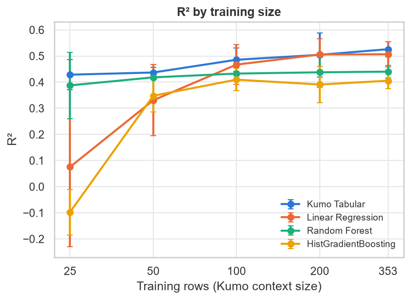

### Interpretation

**Where Kumo Tabular performs better.** On the classification task it was the best model on every metric and never
lost to the strongest baseline on any split. The gain is concentrated in recall: it missed fewer than half as many
malignant tumours as Logistic Regression. It also provides calibrated-looking regression intervals without extra
work. In regression it was much more robust than the linear model with 25 to 100 training rows.

**Where it performs worse or offers no clear advantage.** With 100 or fewer labelled rows it was no better than
Logistic Regression for classification. On the full diabetes data its mean metrics are the best, but
the advantage over Linear Regression is within split-to-split noise. A dataset whose signal is mostly linear and
noisy leaves little room for a more expressive model. On the GTX 980M it was, together with the 500-tree Random Forest, the most expensive model per prediction call.
Its time per split was about 6 to 220 times that of the linear models across the hardware and runs measured
(GTX 980M locally, Tesla T4 on Kaggle), because millisecond-scale baseline timings are noisy. Because there
is no trained model to reuse, every new prediction call processes the whole context again.

## Visualisations

All figures are in [`results/figures/`](results/figures/).

| | |
|---|---|
| 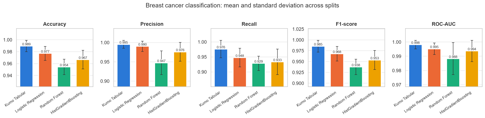 | 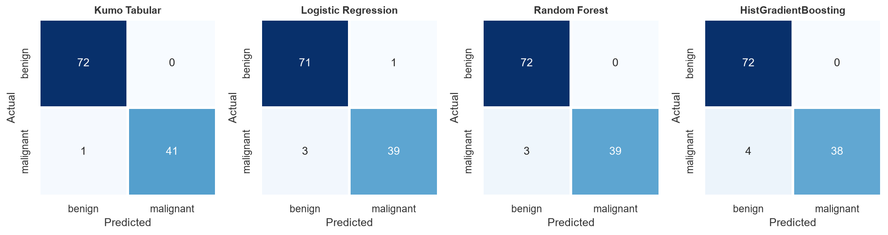 |
| 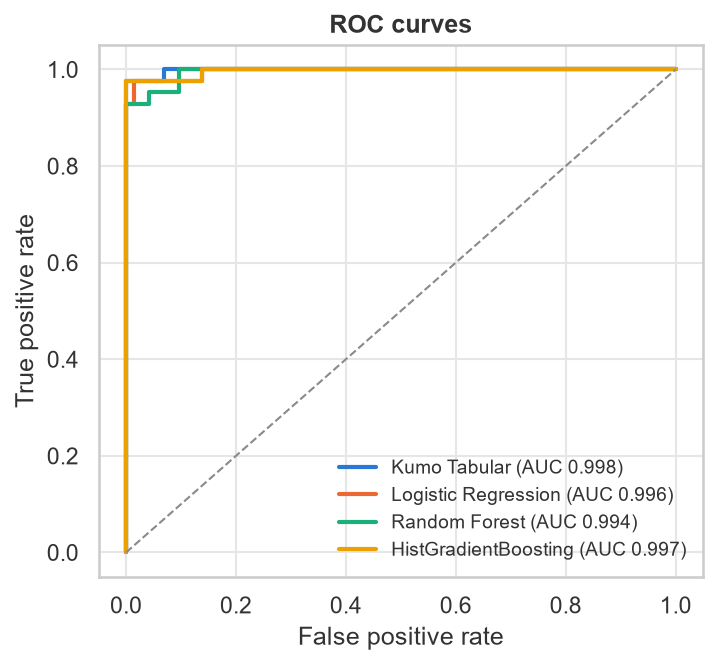 | 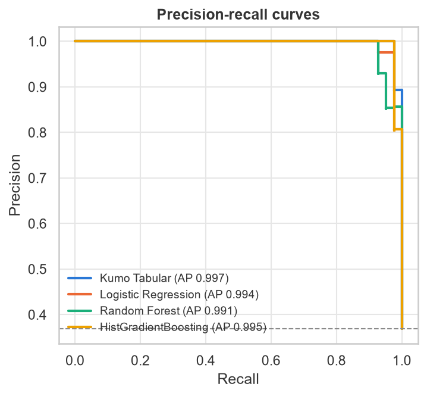 |
| 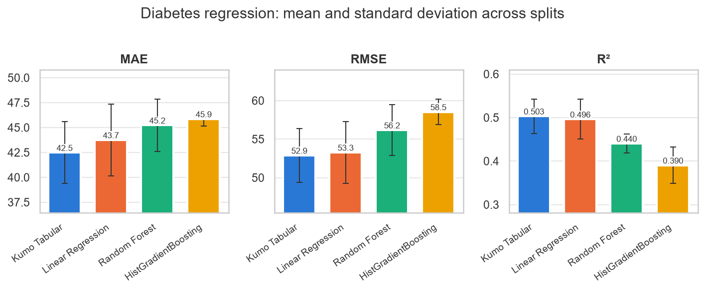 | 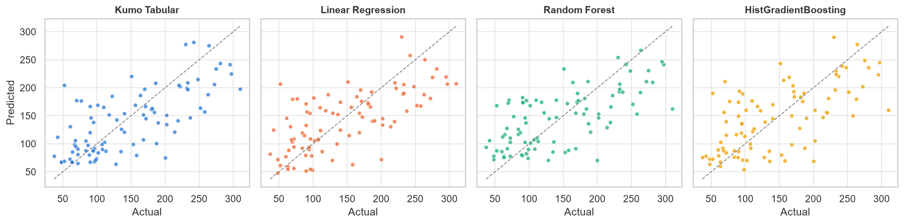 |
| 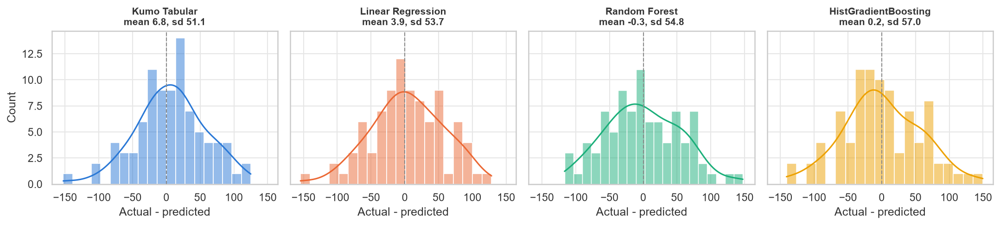 | 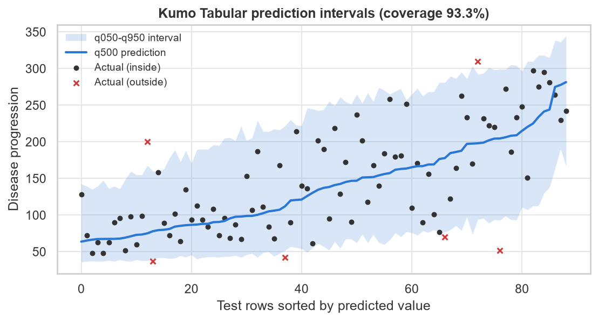 |
| 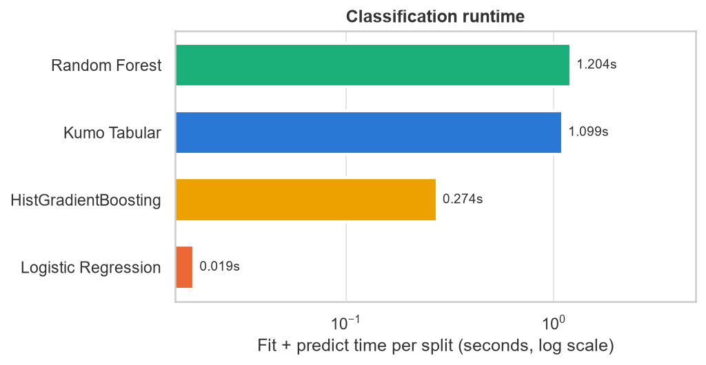 | 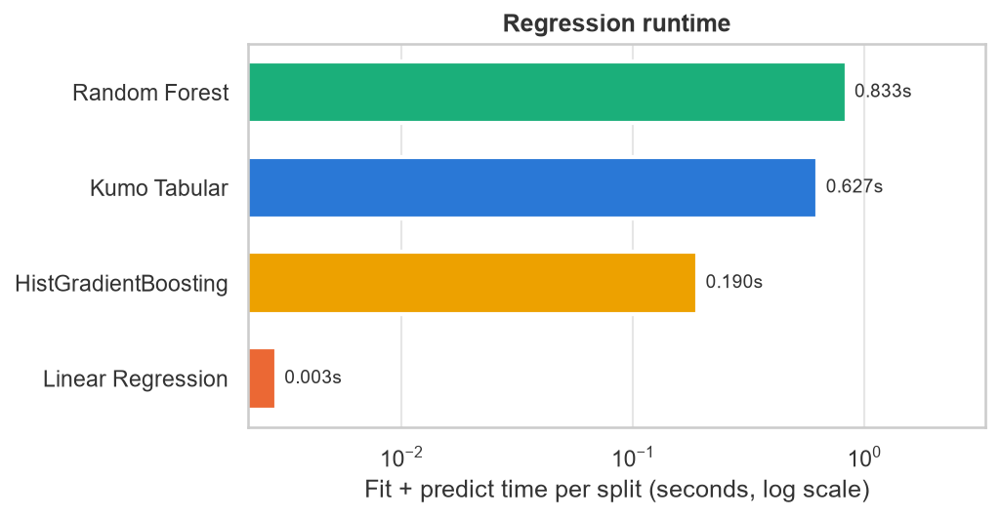 |
| 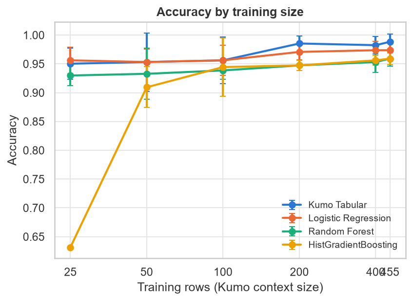 |  |

## Installation

Python 3.11 or newer is required by `structured-data-models`. Clone the repository, then create and activate a
virtual environment from its root directory:

```bash
python -m venv .venv
```

```bash
source .venv/bin/activate
```

On Windows, activate it with `.venv\Scripts\activate` instead.

Install a PyTorch build that matches your GPU first (see [pytorch.org](https://pytorch.org/get-started/locally/)),
then the remaining dependencies. Recent CUDA builds of PyTorch drop kernels for some older GPU architectures. The
results in this README were produced on a Maxwell GPU with the CUDA 12.6 build:

```bash
pip install torch --index-url https://download.pytorch.org/whl/cu126
pip install -r requirements.txt
```

The Kumo Tabular `small` checkpoints (about 110 MB each) are downloaded from Hugging Face on first use. No account
or token is needed.

## Usage

Run both benchmarks and write results and figures to `results/`:

```bash
python scripts/run_all.py
```

Run a single experiment, or override the Kumo model size or device:

```bash
python scripts/run_classification.py
python scripts/run_regression.py --device cpu
python scripts/run_all.py --size medium
```

Other settings (seeds, test size, number of estimators, baseline parameters) are in
`configs/experiment_config.yaml`. Each run writes, per task:

- `results_by_seed.csv`: one row per model and split, including status, errors, metrics and timings,
- `summary.csv`: mean and standard deviation per model,
- `leaderboard.csv`: best model per metric and the gap between Kumo and the best baseline,
- `paired_comparison.csv`: per-split wins, ties and losses against the best baseline,
- `sample_size_study.csv`: all models on training subsamples of increasing size,
- `environment.json`: software versions, device and configuration.

Run the tests:

```bash
python -m pytest
```

Two tests load the real Kumo Tabular model and are skipped if it is unavailable.

The notebooks are generated from `src/` so that they stay identical to the repository code. After changing `src/`,
rebuild and execute them with:

```bash
python scripts/build_notebooks.py --execute
```

## Kaggle Notebooks

The notebooks are published on Kaggle and are self-contained: they install `structured-data-models`, write the
project modules into a temporary directory and do not depend on each other or on repository files. When running a
copy, switch **Internet** on in the notebook settings (needed for the package and the model weights). A GPU is
optional.

1. [Classification Benchmark](https://www.kaggle.com/code/nayonahmedlol/nvidia-kumo-tabular-classification-benchmark):
   breast cancer benchmark with ROC and precision-recall curves and error analysis
   ([`01_classification_benchmark.ipynb`](notebooks/01_classification_benchmark.ipynb)).
2. [Regression Benchmark](https://www.kaggle.com/code/nayonahmedlol/nvidia-kumo-tabular-regression-benchmark):
   diabetes benchmark with Kumo prediction intervals, a point-estimate comparison and error analysis
   ([`02_regression_benchmark.ipynb`](notebooks/02_regression_benchmark.ipynb)).
3. [Experimental Analysis](https://www.kaggle.com/code/nayonahmedlol/kumo-tabular-vs-traditional-ml-experiment):
   both benchmarks combined, paired comparison across splits, runtime and the training-size study
   ([`03_results_analysis.ipynb`](notebooks/03_results_analysis.ipynb)).

The notebooks in this repository are stored with the outputs of the run reported above.

## Research paper

The results are written up as a manuscript prepared for submission to IEEE Access:
*An Empirical Evaluation of NVIDIA Kumo Tabular Against Traditional Machine Learning Models on Small Tabular Datasets*,
by MD. Noyon Ahmed Joy (ORCID [0009-0004-9225-4610](https://orcid.org/0009-0004-9225-4610)). It has not been
peer reviewed or published.

| Path | Content |
|---|---|
| `paper/final_submission/Final_IEEE_Manuscript.pdf` | manuscript PDF (IEEE Access template) |
| `paper/final_submission/latex_source/` | LaTeX source, bibliography, tables and figures |
| `paper/build_paper_assets.py` | regenerates the paper's tables, statistics and figures from `results/` |
| `paper/check_manuscript_numbers.py` | checks the numbers quoted in the manuscript text against their source files |
| `paper/final_submission/reproduction/` | outputs of a re-run of all experiments and a record of the Kaggle runs |
| `paper/final_submission/*.md` | reference audit, reproducibility report, AI-use disclosure and submission checklist |

The IEEE Access template files (`ieeeaccess.cls`, `spotcolor.sty`, the IEEE logos and the template fonts) are not
redistributed here, because the fonts are commercially licensed and the class carries no licence statement. To
compile the source, download the LaTeX template from
[ieeeaccess.ieee.org](https://ieeeaccess.ieee.org/authors/preparing-your-article/) and copy those files into
`paper/final_submission/latex_source/`, then run `pdflatex`, `bibtex`, `pdflatex`, `pdflatex` on `main.tex`.

## Limitations

- Both datasets are small and widely used. Kumo Tabular may have seen similar data during pretraining, and the
  results do not show how the methods compare on larger or messier tables.
- Only the `small` checkpoint was evaluated. The `medium` and `large` models were not tested on this hardware.
- Baselines use default hyperparameters. Tuned gradient boosting or regularised linear models could narrow or
  reverse some of the gaps.
- Five splits of a few hundred rows give wide uncertainty. Differences of about 0.01 in accuracy correspond to one
  test row.
- Runtimes come from a single laptop GPU (GTX 980M, without float16 autocast) and a laptop CPU. On recent GPUs Kumo
  Tabular is expected to be considerably faster; the relative cost against linear models will remain large.
- The model only accepts numerical features in this version of the package; categorical inputs are converted by
  its preprocessing recipe. Neither dataset contains categorical features.

## References

1. NVIDIA. *Kumo Tabular* model card. https://huggingface.co/nvidia/Kumo-Tabular
2. NVIDIA. *structured-data-models*. https://github.com/NVIDIA/structured-data-models
3. NVIDIA. *NVIDIA Kumo Tabular Sets a New Accuracy-Efficiency Frontier for Tabular Prediction*.
   https://huggingface.co/blog/nvidia/kumo-tabular
4. W. N. Street, W. H. Wolberg, O. L. Mangasarian. Nuclear feature extraction for breast tumor diagnosis.
   *IS&T/SPIE Biomedical Image Processing and Biomedical Visualization*, 1993.
5. B. Efron, T. Hastie, I. Johnstone, R. Tibshirani. Least angle regression. *Annals of Statistics*, 32(2), 2004.
6. F. Pedregosa et al. Scikit-learn: Machine learning in Python. *JMLR*, 12, 2011.

## License

The code in this repository is released under the MIT License. The Kumo Tabular weights are released by NVIDIA
under the OpenMDW 1.1 license and are not redistributed here.
